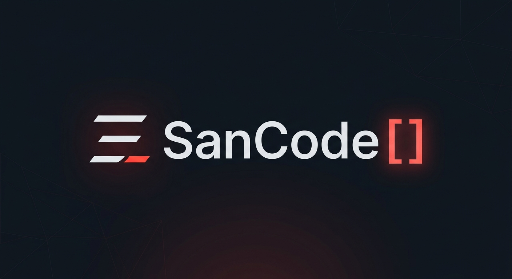

# SanCode | Portafolio Profesional & Enterprise Solutions 🚀

**Arquitectura de Software, Aplicaciones Móviles Fintech, Ecosistemas SaaS y Automatización con Inteligencia Artificial.**

---

## 👨‍💻 Sobre Mí

¡Hola! Soy **Edinson Santiago**, desarrollador de software y creador de **SanCode**. Me especializo en diseñar y construir soluciones tecnológicas robustas que combinan interfaces de usuario de alto impacto visual con arquitecturas de backend y móviles escalables.

---

## 🛠️ Stack Tecnológico & Especialidades

| Frontend & Mobile | Backend & Base de Datos | Automatización & IA |
| :---: | :---: | :---: |
|  |  |  |
|  |  |  |
|  |  |  |
|  |  |  |

---

## 📱 Proyectos Destacados

### 1. 💳 Fintech Cobranza Móvil
* **Descripción:** Plataforma móvil nativa de alto rendimiento para la gestión operativa y financiera de cobranzas en terreno.
* **Capacidades:** Geolocalización satelital para trazabilidad de visitas, métricas analíticas financieras y captura de comprobantes mediante cámara nativa con persistencia offline en Firebase.
* **Stack:** React Native, Expo 57, Firebase Firestore/Auth, Geolocation.

### 2. 🖥️ ShopApp Enterprise & POS
* **Descripción:** Ecosistema SaaS integral compuesto por un panel administrativo web y aplicación móvil de punto de venta.
* **Capacidades:** Creación de empresas, control de inventario en tiempo real con escaneo de códigos, gestión de roles y permisos para trabajadores, y generación automática de reportes en PDF y CSV.
* **Stack:** React 19, TypeScript, Tailwind CSS, Recharts, jsPDF, Expo Print.

### 3. ❄️ Tecnofrio 212 Web
* **Descripción:** Portal web comercial y catálogo digital optimizado para el sector de refrigeración industrial y climatización.
* **Capacidades:** Navegación por categorías de repuestos y compresores, diseño responsive ultrarrápido y optimización SEO orientada a conversión comercial.
* **Stack:** HTML5, CSS3 Moderno, JavaScript.

### 4. 🤖 Willca WhatsApp AI Agent
* **Descripción:** Asistente conversacional autónomo para WhatsApp con memoria contextual por usuario (`sessionId`).
* **Capacidades:** Procesamiento inteligente de intenciones con modelos GPT-4o, automatización de atención al cliente 24/7 y derivación directa a asesores humanos.
* **Stack:** n8n, Meta Cloud API, OpenAI GPT-4o, LangChain, Webhooks seguros.

---

## 📬 Contacto & Asesoría

¿Tienes un proyecto en mente o necesitas desarrollar una solución a la medida? ¡Hablemos!

* **GitHub:** [@EdinsonSantiago89](https://github.com/EdinsonSantiago89)
* **LinkedIn:** [Edinson Santiago](https://www.linkedin.com/in/edinson-santiago-7621ab24a)
* **WhatsApp Directo:** [Escríbenos por WhatsApp](https://wa.me/573194787989)

---

  
<b>SanCode</b> — Lo que piensas, lo que necesitas, se ejecuta.

  
&copy; 2026 Edinson Santiago. Todos los derechos reservados.

